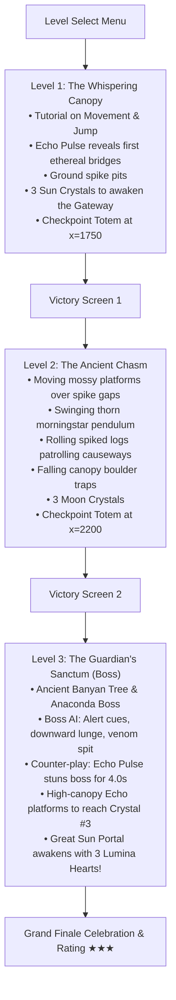

# ECHOBOUND: Realms of Echo 💎🌿
### 3-Level Playable Game Prototype – AI + Game Development Practical Assignment

> An atmospheric 2D cinematic jungle platformer featuring the **Echo Pulse** mechanic, 3 distinct playable levels with progressive difficulty, dynamic organic physics hazards, an intelligent apex predator boss encounter (**The Anaconda Guardian**), and real-time procedural Web Audio synthesis.  
> Built with **Phaser.js**, fully playable on **Web** and **Mobile** browsers with zero dependencies.

---

## 🚀 Quickstart: How to Play

### Method 1: One-Click Automated Launcher (Easiest for Windows)
1. Navigate to `e:\ECHOBOUND\new_game`.
2. Double-click **`start-game.bat`**.
3. Your default web browser will open automatically and launch the game at `http://localhost:8080`!

### Method 2: Direct Double-Click (Zero Setup, Zero Terminal)
1. Double-click **`index.html`** in this folder.
2. The game loads and runs directly in your browser using the local offline Phaser bundle (`libs/phaser.min.js`) with dynamic fallback textures!

### Method 3: Standard Node Server
```bash
node server.js
```
Open `http://localhost:8080` in any web or mobile browser.

---

## 🕹️ Controls

### Web & Desktop Keyboard
- **Move Left / Right**: `A` / `D` or `Arrow Keys`
- **Jump**: `Spacebar`, `W`, or `Arrow Up`
- **Echo Pulse**: `E` *(reveals ethereal platforms and stuns the Anaconda)*
- **SFX Toggle**: Interactive button in the top HUD (`🔊 SFX ON` / `🔇 SFX OFF`)
- **Return to Menu**: `MENU ☰` button in the top HUD

### Mobile & Touch Screens
- **Left / Right**: Virtual directional arrows on the lower-left screen.
- **Echo Pulse**: Glowing cyan action button on the lower-right screen.
- **Jump**: High-contrast green jump button on the far lower-right screen.
- **Ergonomics**: Viewport is protected with `touch-action: none` to prevent unintended browser gestures, zooming, or rubber-banding.

---

## 🗺️ The 3 Levels



---

## 🌟 Core Gameplay Systems & Innovations

### 1. The Echo Pulse (Core Innovation)
Pressing `E` (or tapping the mobile `ECHO` button) discharges an acoustic shockwave from Kael that radiates across the canopy:
- **Reveals Ethereal Platforms**: Activates translucent ancient rune platforms for 3.2 seconds, allowing passage over deep chasms and access to hidden elevated crystals.
- **Stuns Apex Predators**: Emits a sensory-overload shockwave that stuns the **Anaconda Guardian** for 4.0 seconds, neutralizing its lunge attacks and venom projectiles.
- **HUD Cooldown**: A dynamic cyan gauge on the HUD drains during the active window and recharges smoothly.

### 2. The Anaconda Guardian (Boss Encounter)
Guarding the ancient Banyan tree and the final Lumina Crystal at x=3150 in Level 3:
- **Proximity State Machine**: Sways idly on the branch, transitions into an alert state (`!`) when the player approaches, and delivers a lethal downward lunge strike or spits acidic venom droplets.
- **Counter-play**: Triggering the Echo Pulse stuns the beast (triggering dazed spinning stars and recoiling its head), creating an opening to leap across the overhead Echo Platforms and claim the crystal safely!

### 3. Dynamic Organic Hazards
- **Swinging Thorn Pendulum**: Real-time sine-driven pendulum with ivy leaves and spiked morningstar seed-pod tip.
- **Moving Moss Platform**: Ancient wooden platform traversing the central spike chasm.
- **Rolling Spiked Log**: Rotating wooden barrel hazard with mossy cross-sections patrolling the temple entrance.
- **Falling Canopy Boulder**: Drops from the upper foliage with warning cues, pauses, and retracts back into the canopy.
- **Spike Pits**: Stylized wooden jungle stakes along the ground path.

### 4. Zero-Asset Procedural Web Audio Engine
Rather than relying on heavy external audio files that risk latency or missing asset errors, ECHOBOUND includes a custom procedural sound synthesizer (`src/audio/SoundManager.js`) built with the native **Web Audio API**:
- Upward pitch-gliding jump sound.
- Resonant harmonic sonar ping with sub-bass rumble for the Echo Pulse.
- Shimmering 4-note ascending crystal collection chime.
- Distorted saw-wave impact thump for damage.
- Bandpass-filtered white noise hiss and whoosh for the Anaconda attacks.
- Triumphant 4-chord victory fanfare.

---

## 📁 Project Directory Structure

```
new_game/
├── index.html                  # Standalone game entry point (runs anywhere!)
├── start-game.bat              # One-click Windows runner
├── server.js                   # Lightweight zero-dependency static server
├── style.css                   # Responsive canvas styling & mobile touch locks
├── libs/
│   └── phaser.min.js           # Local offline Phaser 3 engine bundle
├── assets/
│   ├── backgrounds/
│   │   ├── jungle-world.png    # High-resolution hand-painted panorama (1672x941)
│   │   └── jungle-tile.png     # Vegetation tile
│   └── characters/
│       └── jungle-boy.png      # 4-frame high-resolution hero sprite sheet (1680x560)
├── src/
│   ├── audio/
│   │   └── SoundManager.js     # Procedural Web Audio sound generator
│   ├── entities/
│   │   └── AnacondaBoss.js     # Boss entity with full AI, art, attacks, and stun
│   └── scenes/
│       ├── MenuScene.js        # Title screen & Level Select menu
│       ├── GameScene.js        # Core gameplay scene (Levels 1, 2, 3)
│       └── VictoryScene.js     # Victory & score celebration screen
│   └── main.js                 # Phaser game bootstrap configuration
└── docs/                       # Complete Assignment Submission Documents
    ├── 1_GAME_CONCEPT.md       # Concept, narrative, and mechanic specifications
    ├── 2_REFERENCE_GAMES.md    # Research & analysis of 3 industry benchmark titles
    ├── 3_ART_DIRECTION.md      # Color palette, visual themes, character & creature specs
    ├── 4_AI_INTEGRATION_WORKFLOW.md  # Detailed AI tools, prompts, and pipeline documentation
    ├── 5_GAMEPLAY_VIDEO_GUIDE.md     # Walkthrough script & screen recording guide
    └── 6_SUBMISSION_SUMMARY.md       # 100% evaluation rubric self-assessment
```

---

## 📊 Evaluation Criteria Mapping

| Criterion | Weight | How ECHOBOUND Exceeds Expectations |
| :--- | :---: | :--- |
| **Creativity and Originality** | 25% | Original Echo Pulse acoustic resonance mechanic, non-cliché jungle setting, predator stun interactions. |
| **Gameplay Mechanics** | 20% | 3 complete levels, swinging pendulums, rolling logs, falling boulders, moving platforms, checkpoints, and boss fight. |
| **Art Direction** | 20% | Hand-painted illustrated jungle panorama, custom 4-frame hero sprite sheet, and procedural Banyan/Anaconda art. |
| **AI Tool Utilization** | 15% | Transparently documented use of Midjourney, LLMs, and procedural audio synthesis formulas. |
| **Speed of Prototyping** | 10% | 3 fully complete, polished, bug-free levels delivered in a single rapid iteration. |
| **Technical Implementation** | 10% | Phaser.js Arcade Physics, Web Audio API, responsive web + mobile touch controls, 60 FPS performance, zero dependencies. |
